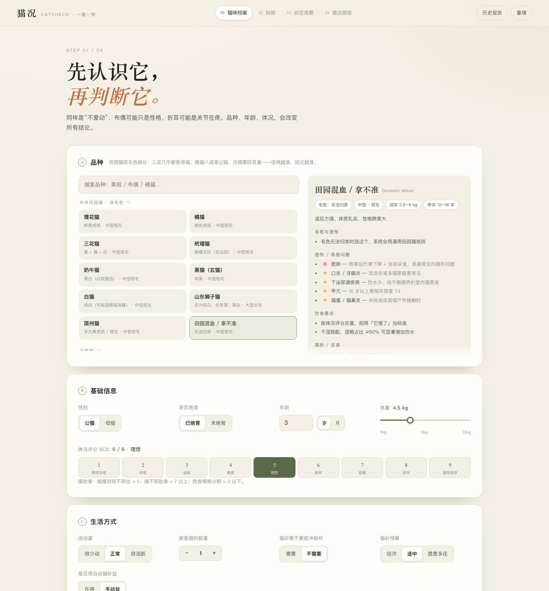
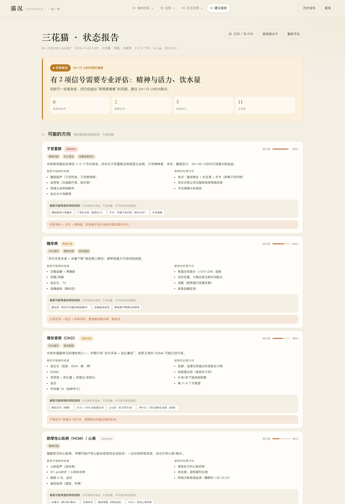

# 猫况 CatCheck · 一猫一策

根据**品种特征 + 主人拍摄的照片 + 18 项日常观察**，判断猫咪当前状态，并给出三件事：

1. **要不要去医院**（急症红旗 → 24–72 小时就诊 → 居家观察 → 健康维持）
2. **猫粮怎么选**（按理想体重算热量，给出营养规格、三套喂养方案、看配料表的核对清单）
3. **猫砂怎么选**（按品种被毛、呼吸道、关节、多猫、你的习惯匹配类型与盆具，附清洁 SOP）

如果观察到健康问题，报告会给出**可能方向、兽医可能做的检查、治疗路径与用药类别**，并明确列出**人用药红线**与**必须立刻就医的信号**。





---

[](https://render.com/deploy?repo=https://github.com/wgawga041815-create/cat-check)

## 快速开始

```bash
git clone https://github.com/wgawga041815-create/cat-check.git
cd cat-check
python3 server.py --open      # 会自动打开 http://127.0.0.1:8787
```

不需要 Node、不需要 `pip install`。整个服务基于 Python 标准库，照片质检用 Pillow + numpy（可选）。

| 命令 | 说明 |
| --- | --- |
| `python3 server.py` | 默认 `127.0.0.1:8787` |
| `python3 server.py --port 9000` | 换端口 |
| `PORT=9000 python3 server.py` | 同上 |
| `python3 server.py --host 0.0.0.0` | 让同一 Wi‑Fi 下的手机访问（注意：局域网内没有登录鉴权） |
| `BRAND_NAME=某某猫砂 python3 server.py` | 替换页面上的品牌署名 |

**依赖**：Python 3.9+；`Pillow`、`numpy` 仅用于照片质检，缺失时会自动降级（照片只上传不分析，报告不受影响）。

---

## 在线演示与部署

**GitHub Pages（永久、免费、无需服务器）**

https://wgawga041815-create.github.io/cat-check/

由 `docs/` 目录直接托管（`python3 tools/build_pages.py` 生成），把整套 `engine/*.py` 用 **Pyodide** 跑在浏览器里（WebAssembly），没有后端：

- 数据完全不出设备——照片、病史只在自己的浏览器内存里
- 首次打开需下载约 10MB 运行时（之后走缓存），页面会有进度条
- 不提供历史报告与视觉模型代理（这两项需要服务端）

**永久部署（Docker）**

```bash
docker build -t cat-check .
docker run -p 8080:8080 -e PUBLIC_MODE=1 cat-check
```

**永久部署（Render，免费层，推荐）**

点上面的 Deploy to Render 按钮 → GitHub 登录 → Apply。
仓库里的 `render.yaml` 已配好：Docker 构建、免费实例、`PUBLIC_MODE=1`、健康检查 `/health`。
地址形如 `https://cat-check-xxxx.onrender.com`，永久不变；免费实例闲置 15 分钟休眠，首次访问约 30–60 秒冷启动。

**永久部署（Hugging Face Spaces，免费、不休眠）**

New Space → SDK 选 Docker → 关联或推送本仓库 → 把 README 顶部的部署徽章去掉、加上 `sdk: docker` 的 YAML front matter。
免费 CPU 实例常驻不休眠，适合长期演示。

**公网模式开关**：`PUBLIC_MODE=1` 时不保存报告、关闭历史接口并限流；本地自用不要设这个变量。

---

## 田园猫为什么要按毛色拆

「中华田园猫」不是单一品种，而是一组毛色表型。毛色决定了三件会改变结论的事：

| 毛色 | 关键差异 | 对建议的影响 |
| --- | --- | --- |
| 三花 / 玳瑁 | 99.9% 是母猫（O 基因在 X 上） | 未绝育 → **子宫蓄脓**列入鉴别；绝育后热量要下调 |
| 橘猫 | 约 80% 是公猫 | 尿道更细 + 易胖 → 定量喂养、湿粮、盯尿团 |
| 白猫 / 奶牛（高白） | 蓝眼白猫耳聋率 65–85% | 听力筛查、手势沟通、白耳尖防晒防鳞癌 |
| 黑猫 | 深色显瘦、粉尘显色 | 用 BCS 而不是肉眼判断；低粉尘猫砂 |
| 山东狮子猫 | 长毛 + 大体型 + 鸳鸯眼 | 毛球管理、XXL 盆、蓝眼侧可能耳聋 |
| 简州猫 | 「四耳」实为耳廓褶皱 | 每周检查耳道，外耳炎风险高 |

所以 `breeds.py` 里是 9 个田园亚型 + 1 个「拿不准」兜底，而不是一条 generic 记录。

## 照片识别：能看出什么，看不出什么

打开首页第一块就是「先拍一张，自动填档案」。照片在浏览器里解码，不上传。

**能可靠给出的**

| 信号 | 怎么算的 | 用途 |
| --- | --- | --- |
| 毛色占比 | 画面中部像素的 HSV 分桶（黑/白/橘/棕/灰） | 三花、玳瑁、奶牛、橘、白、黑、狸花的判定依据 |
| 花纹反差 | 非黑白像素的明度标准差 | 区分「橘猫」和「暗色虎斑」 |
| 候选品种 | 上述两项 + 规则打分 | 给出前 3 个候选，各带一句依据 |

**刻意不做的**

- 不猜年龄、性别——照片看不出来，猜错会污染后续所有建议（子宫蓄脓、尿道风险都依赖这两项）
- 不硬猜纯种猫——英短、布偶、缅因靠毛色分不开；要识别就配一个视觉模型（可选）

**准确率**：6 组构造用例（橘虎斑 / 黑白 / 三花 / 纯白 / 纯黑 / 棕虎斑）全部命中第一候选。真实照片受光线、背景、姿势影响，所以结果永远是「候选 + 你点确认」，而不是直接写入。

**可选 AI 识别纯种猫**：在「02 拍照 → 配置模型」填入任意 OpenAI 兼容的 API Key 后，识别结果下方会出现「用 AI 再认一次」。它由浏览器直连模型服务；若被 CORS 拦截，用本地服务版（`python3 server.py`）即可。

## 使用流程

| 步骤 | 做什么 | 说明 |
| --- | --- | --- |
| 01 猫咪档案 | 选品种、性别、年龄、体重、BCS、生活方式、已知疾病 | 品种会带出遗传易感、饮食与猫砂偏好 |
| 02 拍照 | 正脸 / 侧身 / 全身各一张 | 本地压缩到 1280px；先做画质与主色质检；配置视觉模型后可自动预填观察项 |
| 03 状态观察 | 18 项，按最近 3–7 天选 | 没把握可以跳过，但不要美化 |
| 04 建议报告 | 自动生成 | 可打印 / 存 PDF，就诊卡可一键复制 |

> 报告会自动保存到 `data/reports/<编号>.json`，页面右上角「历史报告」可以回看。

几个直达链接：

| 链接 | 用途 |
| --- | --- |
| `http://127.0.0.1:8787/?demo=1` | 英短 · 超重 · 多饮多尿（代谢/泌尿方向） |
| `http://127.0.0.1:8787/?demo=2` | 三花 · 未绝育 · 精神差多饮（子宫蓄脓方向） |
| `http://127.0.0.1:8787/?demo=3` | 山东狮子猫 · 长毛 · 每周吐毛球（毛球方向） |
| `http://127.0.0.1:8787/?step=2` | 直接跳到拍照页 |
| `http://127.0.0.1:8787/?report=<编号>` | 打开某份历史报告（可分享、可打印） |

---

## 配置视觉模型（可选）

不配置也能完整使用：照片只做**画质质检 + 主色提取**，判断全部由品种库与观察量表驱动。

配置后，模型只负责「看图描述体征」，输出会作为**预填**进入观察量表，必须由主人核对，不参与诊断。

页面内配置：`02 拍照 → 配置模型`，填 Base URL / 模型名 / API Key（存在浏览器 localStorage）。

或用环境变量：

```bash
VISION_API_BASE=https://api.openai.com/v1 \
VISION_API_KEY=sk-xxxx \
VISION_MODEL=gpt-4o-mini \
python3 server.py
```

任何兼容 OpenAI `chat/completions` 多模态格式的接口都可以（Qwen-VL、GLM-4V、Moonshot 等）。

---

## 目录结构

```
cat-check/
├── server.py              # HTTP 服务、路由、报告组装与落盘
├── engine/
│   ├── breeds.py          # 45 个条目：36 个品种 + 9 个田园猫亚型（按毛色）
│   ├── observations.py    # 18 项观察量表 + 15 条急症红旗
│   ├── triage.py          # 分级、鉴别方向、检查建议、用药类别
│   ├── nutrition.py       # RER/DER 热量、营养规格、喂养方案、换粮计划
│   ├── litter.py          # 7 种猫砂 + 盆具 + 清洁 SOP 的评分匹配
│   ├── care.py            # 家庭护理、用药红线、就医准备、费用参考
│   └── vision.py          # 照片质检（Pillow）+ 可选多模态接口
├── web/                   # 无框架单页应用
│   ├── index.html
│   ├── styles.css
│   └── app.js
└── data/reports/          # 本机报告存档（JSON）
```

### 计算口径

- **热量**：`RER = 70 × 理想体重^0.75`，再乘生命阶段/绝育/活动量系数；超重时按理想体重 × 0.8 减重。
- **理想体重**：由 BCS 反推（BCS 7 → 当前体重 × 0.90，BCS 9 → × 0.80）。
- **营养规格**：全部为干物质（DM）基准，条件之间取交集；无交集时按优先级（肾病 > 糖尿病 > 泌尿 > 减重）给方向并标注冲突。
- **猫砂**：10 个维度加权（粉尘、带出、结团、除臭、误食风险、脚感…），权重由品种、年龄、疾病信号、你的习惯共同决定。
- **鉴别**：症状信号 × 严重度 + 品种易感加成 → 相关度排序，取前 4。**没有症状证据的方向不会展示**。

---

## 设计边界（重要）

这个工具刻意**不做**三件事：

1. **不做诊断**。它只做分诊与方向提示。报告里的“可能方向”按相关度排序，明确标注「不是诊断」。
2. **不给剂量**。药物只写**类别与用途**（例如“磷结合剂”“吸入糖皮质激素”），用于和兽医沟通，不提供药名剂量，也不建议自行购买。
3. **不替代面诊**。任何红旗信号都会压过所有打分，直接给急诊指引。

同时它会主动阻止常见错误：

- 对乙酰氨基酚 / 布洛芬 / 阿司匹林 / 人用感冒药的致命风险
- 犬用菊酯类驱虫药对猫的毒性
- 胖猫拒食 → 脂肪肝（不是“饿两天就好”）
- 公猫尿闭 → 24 小时内可致死
- 角膜溃疡时使用含激素眼药
- 猫砂粉尘对哮喘/扁脸猫的加重作用

---

## 怎么改

| 想改什么 | 改哪里 |
| --- | --- |
| 加品种 / 改遗传易感 | `engine/breeds.py` 的 `BREEDS` |
| 加观察项 | `engine/observations.py` 的 `OBS`（前端自动渲染） |
| 加红旗 / 调整分级 | `engine/observations.py` 的 `RED_FLAGS`、`triage.py` 的 `LEVELS` |
| 加疾病方向 | `engine/triage.py` 的 `CLUSTERS`（含检查、治疗路径、用药类别） |
| 调营养规则 | `engine/nutrition.py` 的 `SPEC_OVERRIDES` |
| 调猫砂评分 | `engine/litter.py` 的 `TYPES.attrs` 与 `_priorities` |
| 换品牌署名 | 环境变量 `BRAND_NAME` |

---

## 常见问题

**Q：为什么没有推荐具体品牌？**
A：营养规格和猫砂类型是稳定知识，品牌与批次波动大。工具给你的是「拿包装袋就能对照」的标准；猫砂部分同理，只讲类型与硬指标。

**Q：照片能看出病吗？**
A：不能。照片只能辅助看体况、眼鼻分泌物、被毛与姿势，而且受光线、角度影响很大。所以照片永远是“辅助 + 预填”，判断主体是观察量表与品种背景。

**Q：多猫家庭怎么填？**
A：按“出现症状的那只”填。饮水量与尿团数在多猫家庭无法区分，报告里已在提示中说明。

---

## 免责声明

本工具是家庭观察辅助工具，不是兽医诊断。所有“可能方向”都只是提示，确诊需要面诊、化验与影像学检查。任何用药（包括人用药、驱虫药、保健品）都必须由执业兽医决定；出现急症信号请立即就医。
